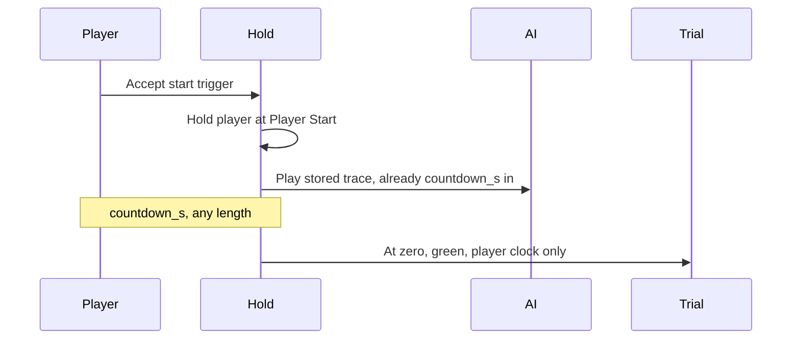

# Hillclimb in freeroam

Design record. Not implemented yet.

The classified run is a BeamNG time trial for the player alone. The other car the player meets is a kept dry run for that stage and weather, played back on the same path, already `countdown_s` into its run when the player gets the green light. Its time is known before the start and is shown as the singleplayer field. It is not a player result. A stage is a short spontaneous section, about one to three minutes, with two attempts. The better valid attempt is the one that counts, inside the weather it was driven in. The vehicle digest and the central leaderboard apply only to the player.

The session layer already survives `core_levels.startLevel` because [`alpinert.lua`](../mods/autoroad_alpine_rt/lua/ge/extensions/alpinert.lua) stays loaded ([`modScript.lua`](../mods/autoroad_alpine_rt/scripts/modScript.lua)) and `jsonWriteFile` stores state in the BeamNG user folder. BeamNG itself provides the clock, the checkpoints, and the local mission best. This repo has no hillclimb mission and no network yet. `session.segments` stays the placeholder for pass times. BeamNG.drive is not installed on the machine where this note was written. Lua function names are checked against the installed game when the feature is built. The layout follows the current modding docs: [missions](https://documentation.beamng.com/modding/levels/gameplay_data/) and the [Race/Path Editor](https://documentation.beamng.com/world_editor/windows/race_path_editor/).

## Constraints

- **HTTP and a database.** BeamNG GE Lua can POST with LuaSocket `socket.http`. A leaderboard is request and response. MQTT has no client in the game, and the traces are too large for it. TLS via LuaSec is not reliable here, so the endpoint is plain HTTP on a network the operator controls. The base URL lives only in `settings/alpine_rt/climb.json`, not in git.
- **A version code per stage**, set by the author. The board key is mission id plus version. Moving the start, the finish, or rebuilding the road in terrain-worker changes what a time means, so the code is bumped. This repo cannot see a mesh rebuild. The code is an explicit value, not a hash.
- **A clean car for each attempt, then the previous state.** Before the first countdown, `beamstate.save` writes the physical state (nodes, broken beams, deformed beams) to `settings/alpine_rt/damage_stash.json`. The same vehicle is repaired in place before each attempt. Classification starts from zero damage. The street stash is loaded back when the event ends (after the second attempt, on abort, or on leaving the stage area), not between the two attempts. Load accepts the file only when the node and beam counts match, so the config must be the same. A vehicle change during an attempt is invalid. The original model and this stash are what comes back. The repair this mod applies before the green light is not a rejected repair. A repair after the green light is. If the repair fills the tank, the previous fuel level is written back. A portal applies the stash on the next map when it was not applied yet. After that, a portal still drops damage, as it does today.
- **A stage lasts about one to three minutes.** The author's pin lap stores `reference_time_ms`. A stage is eligible for the central board only when that time is between 60 and 180 seconds. The section stays something you meet on the road, not a stage you prepare for.
- **Weather is part of the result.** At the green light the run stores the alpineRT weather class already used for that map: `sun`, `clouds`, `rain`, or `snow`. The board is mission id, version, and that class. A rain time is compared with other rain times. The class at the finish is stored as well when it differs, and the class at green is the one that files the run.
- **The classification is one car at a time.** Only the player is in the time trial. Their clock runs from their green light to their finish. The car ahead is a stored recording with a fixed time. That time is the singleplayer comparison for this weather. It is not uploaded and it is not mixed into the player board. There is no blue flag. The recording is a physics vehicle, so passing it is still a fight on the road. The gap is short, 10 seconds by default, so a clearly faster car still meets the one ahead.
- **One countdown, any length.** The time trial only has a short 3-2-1 sequence and no duration setting. The visible start clock is ours: `countdown_s` in `alpine_rt.json`, in simulation time, any length while the player is held. At zero the player is released and the time-trial clock starts. The mission's 3-2-1 sequence is not played as well.
- **The classified clock is the time trial.** Ordered pathnodes, a start trigger, a finish time, and the mission's local best. Files live in `gameplay/missions/<level>/timeTrial/<missionId>/` as `info.json` and `race.race.json`. The player is the only classified entrant. Start and finish sit before the portal boxes. An accepted run that reaches a portal is aborted, then the map change proceeds as today. Finishing stays in the same freeroam session.

## On the map

- The freeroam offer is the mission **start trigger**. Accepting opens the start phase. Driving on leaves the trigger alone, and no clock runs. The offer and the countdown explain the event in a few lines: this is an optional hillclimb, your clock starts at green and only your car is classified, the other car is a recorded run for this weather and is already on the road, its time is fixed and shown locally, there is no blue flag, you get two attempts and the better valid one counts, and the weather right now is part of the result. The lines stay up through the countdown, which is when the other car is already driving and the reason is least obvious.
- The event is two attempts. Each attempt has its own countdown, its own AI release, and its own clock. A rejected attempt does not count. Of the valid attempts in the same weather class, the faster time is the result. When the two attempts fall in different classes, each valid time stands on the board for its own class. After the first attempt the car is repaired again for the second. The street stash comes back only when the event is over. Leaving the area or aborting ends the event. A single valid attempt is the result when the other one is missing or rejected.
- The time trial contains only the player. Its clock starts when our countdown reaches zero. The mission's 3-2-1 sequence does not run with it.
- After accept: suspend this map's traffic pool (`setTrafficSuspended` in [`alpinert.lua`](../mods/autoroad_alpine_rt/lua/ge/extensions/alpinert.lua)). The player stays held at the race path's Player Start. The recording for the current weather is spawned as that vehicle and played from `countdown_s` into the trace, so it is already ahead when the player starts. Both attempts of the event use the same recording. A second stored car, when the sidecar lists one, is played from `countdown_s` plus `handicap_s`. Green is at zero, and only once the last of those cars is at least `clear_m` (default 25) ahead along the path. If that gap is missing, the display stays on the last second and the player clock does not start. If this weather has no recording, the attempt runs with no other car and the briefing says so.
- Contact with the AI does not change the classification. The time counts when the player takes the pathnodes in order and the digest and the path length pass. There is no blue flag.
- A missed pathnode ends the time trial under its own rules and produces no best time.
- Abort: cancel the mission, enter a portal, change map, or leave the stage area. Despawn the AI, record no time, restore traffic, and put the damage stash back on the vehicle. A vehicle change, or a repair after the start signal, also ends the run, stores the digest with the reject reason, and then restores the same stash.
- Opt-out in the app, default on. On: mission best, digest, trace, and upload when a URL is set. Off: the run is left out of mission progress, out of `results.json`, and out of the upload. If the time trial already wrote the attempt, that attempt is dropped. Older entries stay until cleared.

## Local persistence

The stage is a mission the mission manager loads. Shipped stages live in the mod:

`mods/autoroad_alpine_rt/gameplay/missions/<level>/timeTrial/<missionId>/`

- `info.json` — name, type `timeTrial`, start trigger
- `race.race.json` — start, pathnodes, finish, start position; editable in the Race/Path Editor
- `alpine_rt.json` — `version`, `countdown_s`, `handicap_s`, `clear_m`, `spawn_gap_m`, `reference_length_m`, `reference_time_ms`
- `rivals/<weather>/<id>.json` — one kept dry run: model, config, `time_ms`, and the 10 Hz trace. `weather` is `sun`, `clouds`, `rain`, or `snow`.

The mission id carries the version code (`…_v3`). A new geometry is a new id, so the game's board and the central board share the same boundary. Missions created in the editor stay in the user folder under `gameplay/missions/…`, where the mission editor writes them.

Also in the user folder, independent of the loaded map:

- BeamNG mission progress — the time trial's local best. It lives in the profile and survives `startLevel`.
- `settings/alpine_rt/results.json` — `share`, name, `leaderboard_url`, digest, reject reason, upload queue. The time itself lives in mission progress.
- `settings/alpine_rt/traces/` — one trace per best run: 10 Hz, `t`, position, rotation, vehicle model and config.
- `settings/alpine_rt/damage_stash.json` — physical state from before the run, until it has been loaded back.

`alpinert_climb` uses the same `setExtensionUnloadMode(..., "manual")` as `alpinert` and aborts a running mission before a portal changes the map. After another alpineRT map loads, the app reads progress and `results.json`.

## Singleplayer field

The other times come from dry runs driven by a script controller inside the map. It is not the player event, and the player never waits for it. The controller walks the vehicle list and the four weather classes (`sun`, `clouds`, `rain`, `snow`). For each pair it resets the car to the start, applies that weather, and runs for hours. A stage of one to three minutes gives many attempts in that time. After a finish or a crash the car goes back to the start.

The loop has two phases.

- **Search.** Race-mode AI drives the path on its own. A finish is kept when the pathnodes were taken in order and the time sits in a band around `reference_time_ms`. Wrecks, shortcuts, and crawls are dropped. The best clean finish of that vehicle and weather becomes the current template.
- **Refine.** The template is turned into a velocity profile: target speed along the distance of the race path, taken from the trace (`ds/dt` at each sample). The next attempt follows that profile as a time script (`ai.setScript` / `startFollowing`, checked against the installed `lua/vehicle/ai.lua`). The profile is varied only slightly, a few percent faster or slower on a stretch. The physics car has to drive it. A clean finish that is faster than the template replaces it, and the new trace is the next profile. A variation the car cannot hold is discarded.

The controller writes every attempt to the user folder so a long run can resume. The template that remains for each vehicle and weather is copied into the mission as `rivals/<weather>/<id>.json` (model, config, `time_ms`, trace). Rain stays its own set, because the same config is slower on a wet road. A new version code means new dry runs. The files ship with the mission.

At the event the mod plays one of those traces back as a physics vehicle. At the player's green light the playback is already `countdown_s` into the trace, so the car is already ahead. The time shown for that car is the stored `time_ms`. Both attempts use the same file. The local app lists the kept dry-run times for the current weather next to the player's attempts. The central board stays player-only.

The playback holds the recorded line. It can be bumped and passed. It does not make way.

## Player trace

The GE extension samples only the player's drive at 10 Hz. The trace belongs to the classified run and is part of the upload. It is not added to the dry-run field.

## Vehicle before and after

The classification digest describes the race car, not the road damage from before the run. At the green light the car is the repaired one. At the finish it is whatever the run did to it.

- Object id, model, config name, hash of `partConfig`
- Broken-beam count and deformed-beam count from `beamstate` (field names checked against the installed version)
- At the finish, whether the in-vehicle counter fell below its own peak after the green light
- Position

The app and each board entry show the pair, for example `broken 0 → 12` or `autobello → etk800`. There is no periodic damage poll. The counter runs in vehicle Lua and is read once at the finish. The repair key is also caught with `onVehicleResetted`. The repair this mod applies before the start is excluded. The 10 Hz trace stores position and rotation only.

A run is rejected when any of these is true. The time stays on disk with a reason and is left out of the best and the board. The stash is still restored afterwards:

- **Different vehicle.** Model, config hash, or player vehicle id changed, or BeamNG reports `onVehicleSwitched` / replace. The run ends at that moment.
- **Repair during the run.** `onVehicleResetted` after the green light, or the damage counter drops by more than a small amount of noise below the peak since the start. A clean start and a worse car at the finish stay valid.
- **Shortcut.** A missed pathnode is already a failed time trial. The driven polyline is also under 85 percent of the pinned reference length. A wrecked car at the finish stays valid when the pathnodes and the length match.

The author sets the reference length and `reference_time_ms` in `alpine_rt.json` with the version code, after the race path exists. Without that pin, or when the pin lap is outside 60–180 seconds, times stay local (`unpinned` or `stage_length`) and are not accepted centrally. The server checks the report against the same pin: same identity, damage not improved, 85 percent length from the trace, start and finish points on the pathnodes. The same mission id with a different `race.race.json` is rejected.

## Leaderboard

Contract for the existing HTTP service. A small Python script with SQLite under `tools/` can stand in for a trial and can be left unused:

- `POST /v1/tracks` — once per mission id, with an author token: `reference_length_m`, `reference_time_ms`, and the contents of `race.race.json`. A reference time outside 60–180 seconds is rejected.
- `POST /v1/runs` — `track_id`, `version`, `weather` (`sun`, `clouds`, `rain`, or `snow`), `time_ms`, display name, `client_run_id`, mod revision, `vehicle_before`, `vehicle_after` (including whether damage fell below its peak), path length, trace. `client_run_id` is unique. Response `accepted` or `reason`: `vehicle_changed`, `repaired`, `short_path`, `missed_gate`, `unpinned`, `stage_length`.
- `GET /v1/tracks/{id}/versions/{version}/leaderboard?weather=` — accepted player runs for that weather class, each entry with the before/after pair and the weather.

The trace stays attached to the run for the check. It is not placed on the road as a vehicle.

Offline, the run remains `pending` in `results.json` and is sent with the next successful run. The app always shows the local best, and the central list once a response arrives.

Physics stays on the client. The board is as reliable as the digest and the trace the server checks against the pinned stage. A modified mod can still fake that report. A vehicle swap, a repair, and a coarse shortcut fail on an honest client and on any report that was not altered.

## Build-out

- New extension [`mods/autoroad_alpine_rt/lua/ge/extensions/alpinert/climb.lua`](../mods/autoroad_alpine_rt/lua/ge/extensions/alpinert/climb.lua), loaded from [`modScript.lua`](../mods/autoroad_alpine_rt/scripts/modScript.lua). It hooks the mission manager, plays a kept dry run for the current weather from `countdown_s` into the trace, and writes the digest. [`alpinert.lua`](../mods/autoroad_alpine_rt/lua/ge/extensions/alpinert.lua) suspends traffic and aborts the mission before `queueSwitch`.
- New app `alpineRtClimb` next to the map app: the start-phase briefing and countdown, which attempt this is, the stored time of the car ahead, opt-out, before/after, weather, local mission best, and the central list for the current weather. The running clock after the start stays the time-trial UI. The route and the checkpoints are authored in the Race/Path Editor and the Mission Editor, cut so the pin lap falls between one and three minutes. Rival files are the templates left by the in-map dry-run controller.
- App strings stay English, like the existing toasts. The mission UI brings its own strings.
